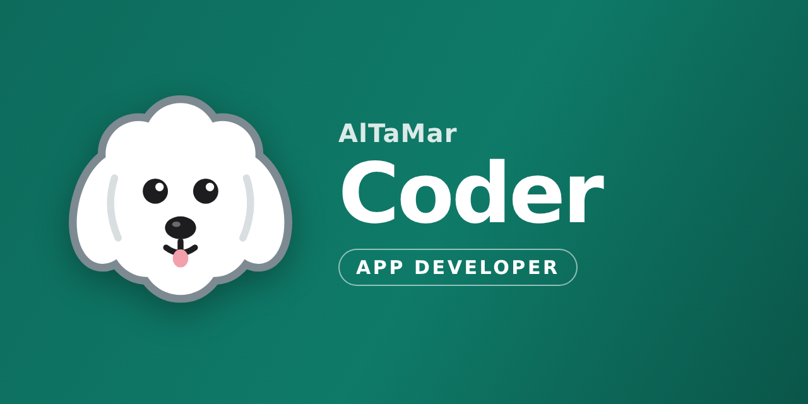

  

<h2 align="center">Hallo, hier ist AlTaMarCoder 👋</h2>

  Kleine, praktische Apps für den Alltag – für Android und das Web. 
  Entwickelt von <b>Al</b>exander, <b>Ta</b>tiana und <b>Mar</b>schulinski.

---

### 📱 Projekte

**Stundenzettel** – monatlicher Stundennachweis fürs Android-Handy · Version 2.1.0 · Deutsch, English, Polski, Română, Українська, Русский
- Arbeitstage antippen, Schichten mit Pausen und eigenen Kürzeln (z. B. F1, S5)
- Schichtplan je Monat mit Soll, Ist und Saldo – auch rückwirkend, Excel-Import und -Export
- Urlaub, Krank, Urlaubsplan fürs Jahr, Feiertage aller Bundesländer
- Stundenkonto, Verdienstrechner und Minijob-Prüfung, mehrere Profile für mehrere Jobs
- Unterschrift mit dem Finger, PDF-Stundenzettel, Versand per E-Mail, Schichtplan in den Kalender
- Alle Daten bleiben nur auf dem Handy – ohne Konto, Werbung und Tracking

→ [Alle Funktionen im Überblick](stundenzettel/README.md)

---

AlTaMar Coder · App Developer

